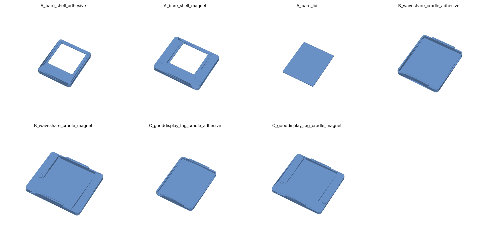

# NFC e-ink phone tag casings

Parametric, 3D-printable casings for 1.54" battery-free NFC e-ink modules
(200 x 200, black / white / red / yellow), with either a flat adhesive back or
magnet wings for mounting on a phone.



## Builds

| Build | Fits | Parts | Outer size (adhesive / magnet) |
|---|---|---|---|
| A | Bare module: panel + NFC driver board (Shellrus module, or Good Display GDEM0154F51H + NFC-D1-0154) | `A_bare_shell_*` + `A_bare_lid` | 35.5 x 42.8 x 4.3 / 49.5 x 42.8 x 4.3 mm |
| B | Waveshare 1.54inch NFC-Powered e-Paper (G), already cased | `B_waveshare_cradle_*` | 44.5 x 51.0 x 6.3 / 58.5 x 51.0 x 6.3 mm |
| C | Good Display finished tag (GDNS0154AL / GDP0154NF2) | `C_gooddisplay_tag_cradle_*` | 39.8 x 50.3 x 4.8 / 53.8 x 50.3 x 4.8 mm |

Files are in `cases/out/`: `.stl` to print, `.step` to edit in CAD.

## Measure before you print

The models are built from datasheet and reseller figures, not from a part on
the bench. Check these with calipers and edit the value at the top of
`cases/nfc_eink_cases.py`, then re-run it.

| Parameter | Default | Source |
|---|---|---|
| `BareModule.panel_w/h/t` | 31.80 / 37.32 / 1.00 | panel datasheet |
| `BareModule.active_top` (panel edge to first pixel row) | 1.90 | estimate |
| `BareModule.board_w/h/t` | 31.85 / 37.65 / 0.58 | reseller listing, unconfirmed |
| `BareModule.parts_t` (tallest component) | 1.00 | estimate |
| `WAVESHARE_G.t` (module thickness) | 4.5 | estimate, not published |
| `WAVESHARE_G.w/h` | 41.28 / 47.84 | Waveshare listing |
| `GOODDISPLAY_TAG.w/h/t` | 36.59 / 47.09 / 3.0 | Good Display listing |

```bash
pip install cadquery matplotlib
```

```bash
python3 cases/nfc_eink_cases.py
```

```bash
python3 cases/preview.py
```

## Print and assemble

- 0.2 mm layers, 0.4 mm nozzle, PETG or PLA, no supports.
- Build A shell prints window-face down. Lay the panel face-down in the shell
  with its top edge against the top wall, fold the driver board over it on
  thin double-sided tape, drop the lid into the rebate and fix it with a drop
  of glue or the mounting pad itself.
- Builds B and C: press the tag under one clip, then snap it under the other.
- Magnet variants take four 5 x 1.5 mm disc magnets, glued into the pockets
  on the back. The pockets sit on a 51 mm circle (the MagSafe ring) and are
  placed in side wings so no metal covers the NFC coil. On a phone without
  MagSafe, stick a steel ring or plate to the phone or its case.

## Things to know

- Magnets or metal over the coil stop the tag from harvesting power. Keep the
  wing layout; do not move magnets under the board.
- An iPhone's NFC antenna is at the top edge, not behind the MagSafe ring, so
  the tag is updated by lifting it off and holding it to the top of the phone.
  The image stays without power.
- A tag parked permanently over the phone's NFC antenna can interfere with
  contactless payments. Mount it away from the antenna.
- Check phone compatibility per vendor before buying; Waveshare lists some
  Samsung and Google phones as unsupported on a sibling model.
